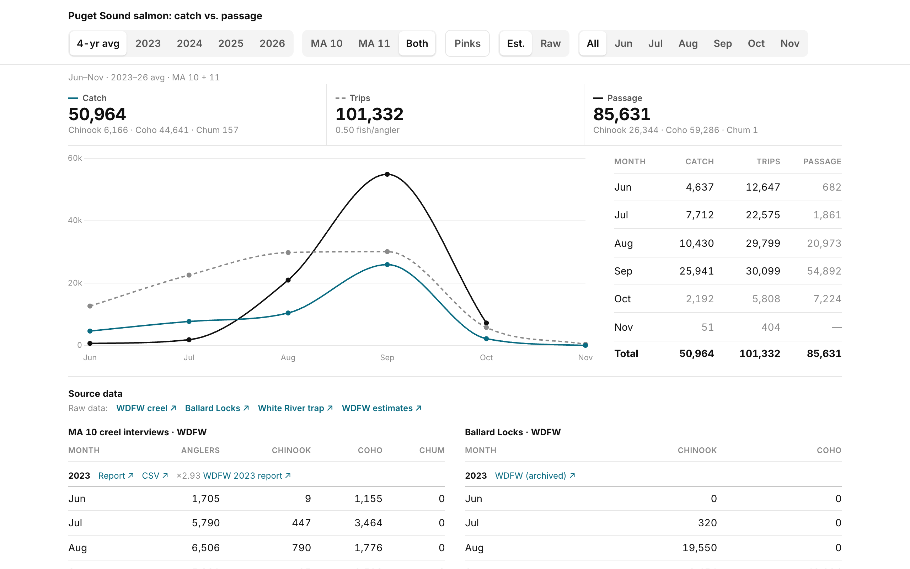
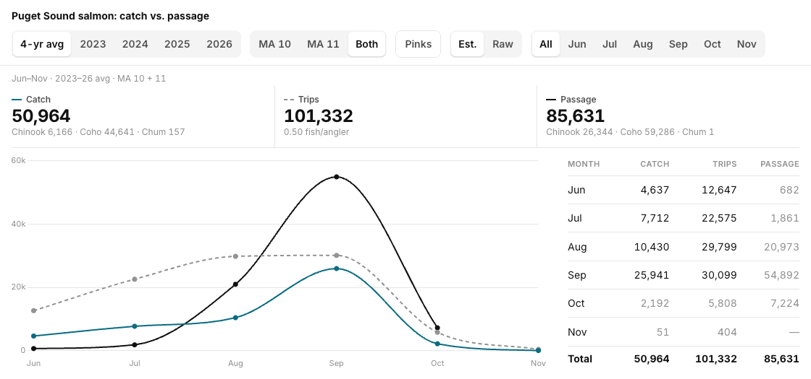
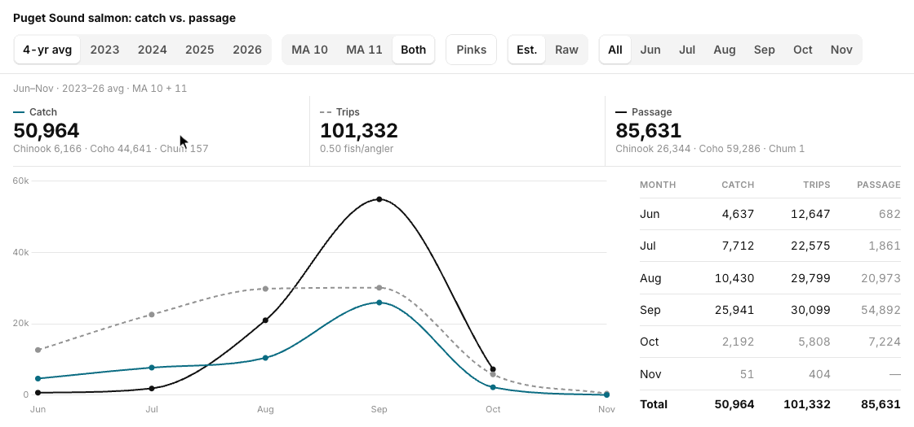
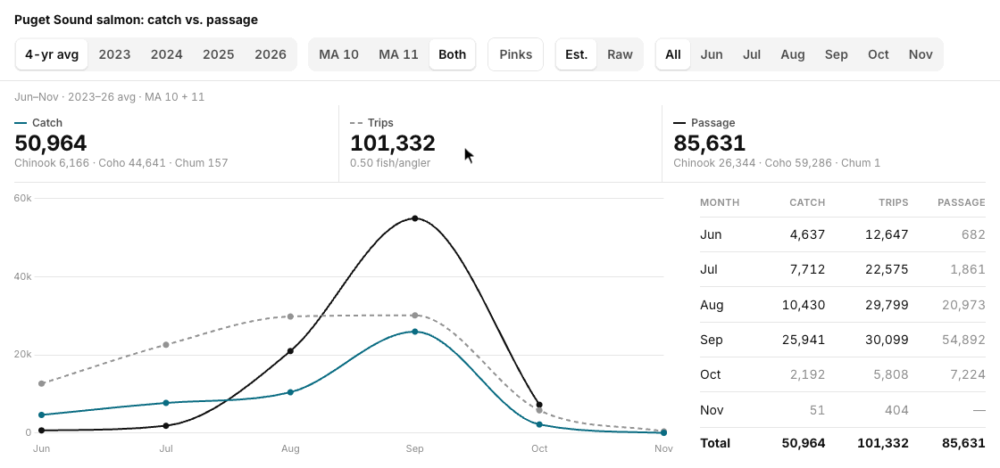
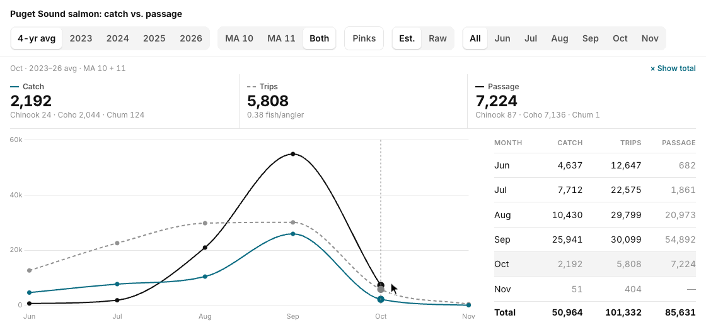

# `fishreports`

Puget Sound salmon, month by month: recreational catch and angler trips in Marine Areas 10 and 11 against fish passage counts, from public WDFW, Army Corps and tribal data. Sources and method are in [DATA.md](DATA.md).

  
[<kbd> haaans.com/fishreports  </kbd>](https://haaans.com/fishreports)

## Features

<table>
<tr valign="top">
<td width="50%">
<h3>Hover through the season</h3>

Run along the chart and the totals and table jump to that month: catch by species, trips, fish per angler and passage.

</td>
<td width="50%">

</td>
</tr>
<tr valign="top">
<td width="50%">

</td>
<td width="50%">
<h3>Flip through the years</h3>

Step through 2023 to 2026 or the four-year average and watch the run's shape change.

</td>
</tr>
<tr valign="top">
<td width="50%">
<h3>Compare the two areas</h3>

Switch between Area 10 with the Ballard Locks counts, Area 11 with the White River trap counts, or both combined.

</td>
<td width="50%">

</td>
</tr>
<tr valign="top">
<td width="50%">

</td>
<td width="50%">
<h3>Estimated or raw</h3>

Creel interviews reach about one angler in three. Est. scales the counts up by WDFW's expansion factors, and Raw shows them as published.

</td>
</tr>
<tr valign="top">
<td width="50%">
<h3>Pin a month</h3>

Click a row to lock the page onto that month, then click it again to go back to the season total. Every filter lives in the URL, so a view is a link.

</td>
<td width="50%">

</td>
</tr>
</table>
